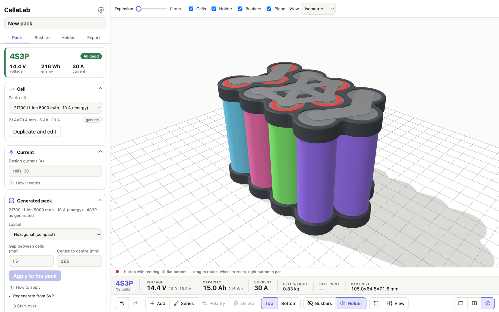
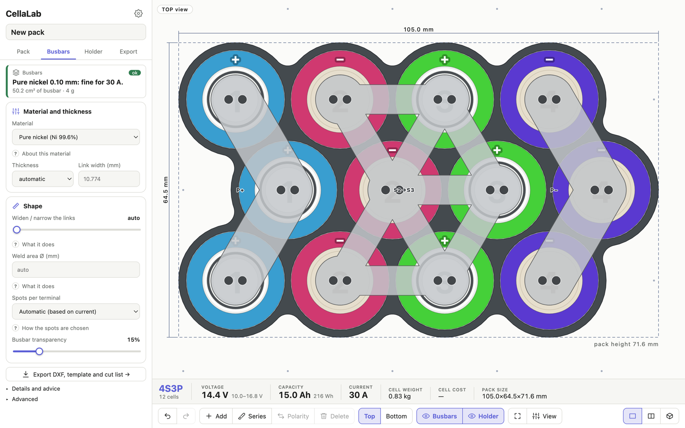
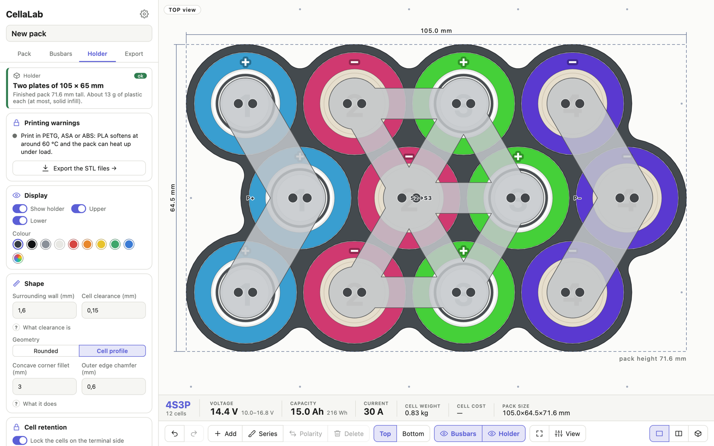

# CellaLab

[](https://github.com/altrdev/cellalab/actions/workflows/ci.yml)

**Configuratore per pacchi batteria fai-da-te, nel browser.** Disegni il pacco (o lo generi da serie e parallelo), lo guardi in 3D e ne esporti il portacelle da stampare e le lamelle da tagliare.

[🇬🇧 English](README.md) · Italiano



## Cosa fa

- **Pacco:** generazione automatica S×P (disposizione esagonale o quadrata) oppure disegno libero cella per cella; serie a pennello, gruppi in parallelo, polarità, annulla/ripristina. Calcola tensione, capacità, energia, corrente, peso, costo e ingombro.
- **Celle:** catalogo con profili generici e 14 modelli 18650/21700 (BAK, Samsung, Molicel, Murata, LG) con prezzi indicativi; si possono duplicare e modificare.
- **Corrente e BMS:** la corrente del pacco è la più bassa tra quella delle celle e il limite del BMS; le lamelle si dimensionano su quel valore.
- **Verifiche:** celle sovrapposte, spazio minimo per il portacelle, gruppi sbilanciati, polarità, limite sopra ciò che reggono le celle.
- **Anteprima 3D** (three.js): disegno e 3D affiancati, esplosione, viste isometrica/alto/frontale/laterale.
- **Lamelle:** generate dalla topologia, dimensionate su materiale, spessore e corrente (nichel, rame, ecc.), con punti di saldatura consigliati. Esportazione **DXF** per laser/CNC (con compensazione del taglio), dima **SVG** 1:1 e lista di taglio.
- **Portacelle stampabile in 3D:** due piastre su misura con tasche, fondo che trattiene le celle, raccordi e smusso a rampa liscia. Esportazione **STL** in posizione di stampa. Le piastre più grandi del piano di stampa si dividono in pezzi da incollare (il taglio passa nella parete tra le celle), con un STL per pezzo e uno ZIP con tutti.
- **Progetto:** salvataggio automatico nel browser; salva e apri file `.cellalab.json` (include le impostazioni di lamelle e portacelle).

Interfaccia in italiano e in inglese (segue la lingua del browser); lunghezze in mm o pollici, temperature in °C o °F, pesi in g/kg o oz/lb, prezzi in €, $ o £: le impostazioni sono nell'ingranaggio accanto al titolo. I file da tagliare seguono l'unità di lunghezza (DXF, dima SVG); l'STL è sempre in mm.

## Schermate

| | |
|---|---|
|  |  |
| Lamelle: materiale, forma e punti di saldatura | Portacelle: forma, gioco e smusso |

## Avvio rapido

Serve Node 22 o più recente.

```bash
npm install
npm run dev      # sviluppo, di solito su http://localhost:5173
npm test         # test (Vitest)
npm run check    # controllo dei tipi (svelte-check)
npm run build    # versione di produzione in dist/
```

## Come si usa

1. **Pacco:** scegli «Genera automaticamente» (imposti S, P, cella e spazio tra le celle) oppure «Disegna a mano».
2. **Lamelle:** scegli materiale, spessore e saldatrice; la scheda mostra l'esito e gli avvisi.
3. **Portacelle:** regola pareti, gioco, fondo e smusso.
4. **Esporta:** DXF, dima, lista di taglio, STL e salvataggio del progetto.

## Stato e limiti

Progetto hobby in sviluppo.

- L'STL del portacelle si apre e viene affettato senza errori in Bambu Studio, ma nessun portacelle è stato ancora **stampato**: controlla sempre l'anteprima nello slicer prima di stampare. Le piastre grandi divise in pezzi incollati non sono state provate su una stampa reale.
- Il dimensionamento termico delle lamelle è una stima a regime stazionario (modello ad aletta, estremi alla temperatura di salita fissata sulle celle): ignora la resistenza dei punti di saldatura e dei contatti e non è stato confrontato con un pacco reale.
- Il DXF in pollici e il modello SVG in pollici non sono mai stati aperti in un vero programma CAD o laser.
- Le lamelle sono a un solo livello e di spessore unico.
- Prezzi e correnti delle celle sono indicativi (da nkon.nl, novembre 2026) e vanno verificati sulla scheda tecnica.
- Il 3D è stato provato con rendering software, non su GPU reale.

## Sicurezza

Un pacco di celle al litio può incendiarsi o esplodere se progettato o costruito male. CellaLab è un aiuto al progetto, **non una certificazione**: i risultati sono stime, fornite così come sono e senza garanzie (vedi la [licenza](LICENSE)). Sei tu il responsabile di ciò che costruisci.

- Verifica ogni valore sulla **scheda tecnica** di celle, BMS e saldatrice; prezzi e correnti del catalogo sono solo indicativi.
- Usa un BMS adatto alle celle e alla corrente, fusibili o altre protezioni da sovracorrente e, dove serve, protezioni a livello di cella.
- Non fidarti solo del dimensionamento di lamelle e punti di saldatura: prova un pacco reale sotto carico, controllando le temperature, prima di usarlo.
- Non mescolare mai celle di tipo, età o stato di carica diversi; tieni il pacco lontano da fonti di calore e materiali infiammabili durante carica e prove.
- Maneggia le celle nude con cura: un cortocircuito con un utensile o una lamella libera può causare ustioni o incendio. Usa utensili isolati e copri i terminali scoperti.
- Se hai dubbi, chiedi a una persona esperta prima di costruire.

## Struttura

```
src/core   logica pura (modello, calcoli, verifiche, lamelle, portacelle, DXF/STL), con i test
src/ui     interfaccia Svelte, editor 2D, scena 3D, esportazioni
```

Stack: Svelte 5, TypeScript, Vite, Vitest, three.js, clipper-lib.

## Licenza

[MIT](LICENSE) © 2026 Alessandro Travi
